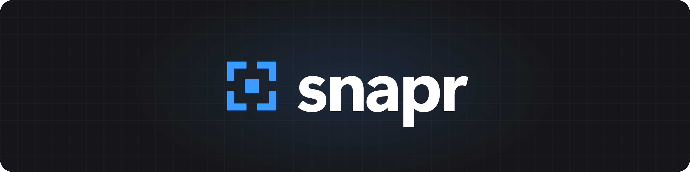

  

snapr is a region screenshot and screen recording tool for Windows, macOS and
Linux. It lives in the system tray: press the hotkey, every monitor freezes,
drag a region, and the result is saved as a PNG and copied to the clipboard.

## Download

| Windows | macOS (Apple silicon) | Linux |
|---|---|---|
| [snapr-windows-x86_64.exe](https://github.com/CubityFirst/snapr/releases/latest/download/snapr-windows-x86_64.exe) | [snapr-macos-aarch64.dmg](https://github.com/CubityFirst/snapr/releases/latest/download/snapr-macos-aarch64.dmg) | [snapr-linux-x86_64](https://github.com/CubityFirst/snapr/releases/latest/download/snapr-linux-x86_64) |

snapr keeps itself up to date from GitHub releases. See [platform
notes](docs/GUIDE.md#platform-notes) for macOS permissions and Linux tray
support. To build it yourself: `cargo build --release`.

## Features

- **Capture**: `Alt + Shift + S` freezes every monitor; drag a region (across
  monitors if you like), click for a whole monitor, Shift for a square.
- **Annotate** on the frozen screen before you capture: pen, line, arrow,
  text, box, ellipse, highlighter, blur, pixelate and image redaction, with
  undo/redo.
- **Record** a region to MP4 or WebM, with HDR, AV1 and optional FFmpeg
  encoding, and pause, restart or abort from the bar beneath it.
- **Upload** to Cloudflare R2, Amazon S3, MinIO, Backblaze B2, img.fish or
  any Pomf host, with the link copied for you. Keys live in the system credential
  store, and administrators can turn uploads off.
- **Tools**: scan QR codes from the screen, pick colours with a magnifier,
  pin a region on top of everything, and combine screenshots side by side.
- **Organise**: recent screenshots with preview, ShareX-style file name
  templates, capture stats, and settings you can search, export and import.

## Guide

The [guide](docs/GUIDE.md) covers everything in detail:

- [Capturing](docs/GUIDE.md#capturing) and [annotating](docs/GUIDE.md#annotating)
- [The main window](docs/GUIDE.md#main-window): recent screenshots, tools, stats
- [Destinations](docs/GUIDE.md#destinations): folders, clipboard and uploads
- [Settings](docs/GUIDE.md#settings) and [naming templates](docs/GUIDE.md#naming-templates)
- [Screen recordings](docs/GUIDE.md#screen-recordings)
- [Updates](docs/GUIDE.md#updates) and the [command line](docs/GUIDE.md#command-line)

Contributions are welcome; see [CONTRIBUTING.md](CONTRIBUTING.md).

## License

The source code is licensed under the
[PolyForm Noncommercial License 1.0.0](LICENSE): free to use, modify and
share for any noncommercial purpose. Commercial use needs separate permission.

The snapr name and logo are not covered by that license and remain all rights
reserved; see [TRADEMARKS.md](TRADEMARKS.md).

snapr includes work by others under their own licenses, credited on the
*About* tab of Settings: the colour picker's names, from
[Name that Color](https://chir.ag/projects/ntc/) by Chirag Mehta
([CC BY 2.5](https://creativecommons.org/licenses/by/2.5/)), with its notices
in [assets/color-names.txt](assets/color-names.txt), and the open-source Rust
crates it's built with, listed with their license texts by `build.rs`.
